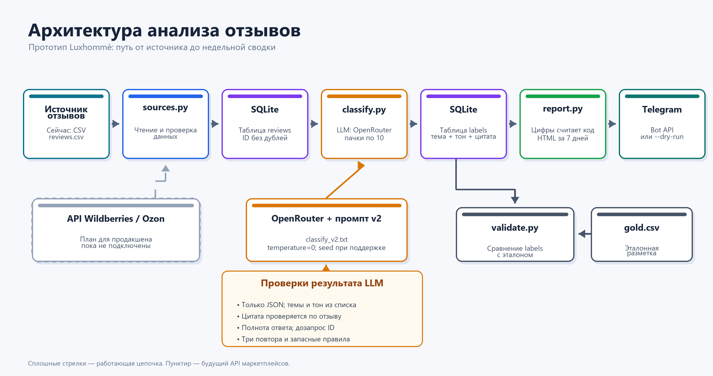
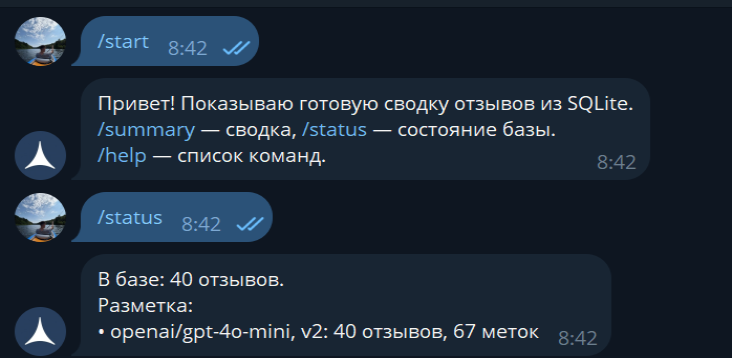
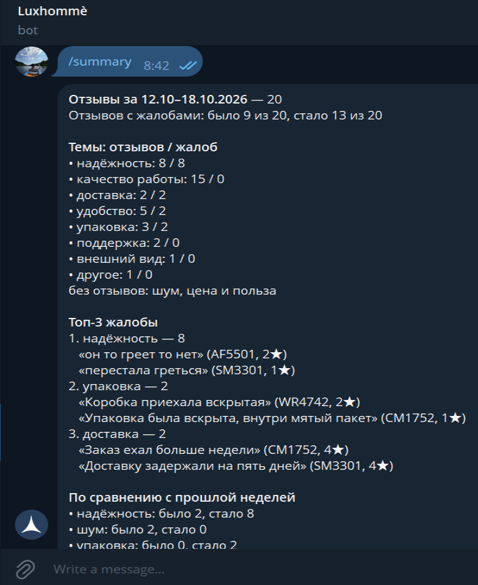
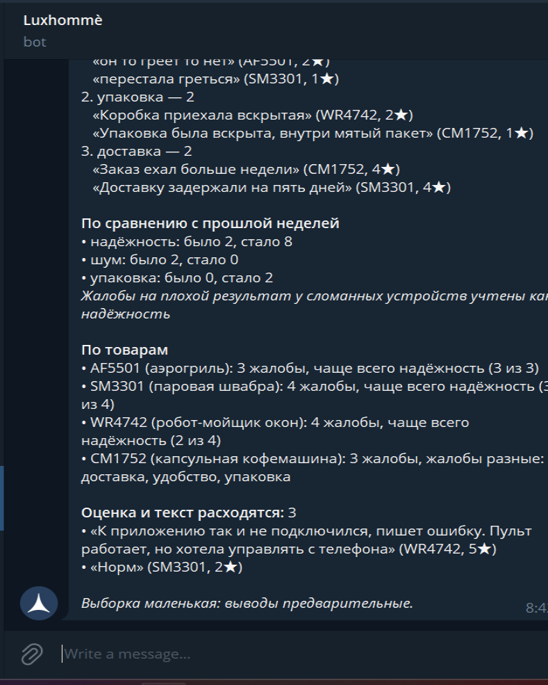

# Анализ отзывов Luxhommè 

## Что это

Небольшой прототип еженедельного анализа отзывов о четырёх товарах. Программа читает CSV, сохраняет отзывы в SQLite без дублей, размечает темы и тон через OpenRouter, сравнивает разметку с эталоном и собирает HTML-сводку для Telegram. Все числа в сводке считает Python, а не нейросеть. «Текущая неделя» — последние семь дней от максимальной даты отзыва в базе, а не от сегодняшней даты.

## Как запустить за 3 шага

1. Откройте PowerShell в папке проекта, где лежит этот README, и подготовьте Python:

   ```powershell
   python -m venv .venv
   .\.venv\Scripts\python.exe -m pip install -r requirements.txt
   ```

   В bash на macOS или Linux:

   ```bash
   python3 -m venv .venv
   .venv/bin/python -m pip install -r requirements.txt
   ```

   Если `.venv` уже создана и зависимости установлены, этот шаг можно пропустить.

2. Создайте рядом с README файл `.env` и заполните своими значениями:

   ```dotenv
   OPENROUTER_API_KEY=ваш_ключ
   OPENROUTER_MODEL=openai/gpt-4o-mini
   PROMPT_VERSION=v2
   TELEGRAM_BOT_TOKEN=токен_бота
   TELEGRAM_CHAT_ID=идентификатор_чата
   TELEGRAM_ALLOWED_CHAT_IDS=идентификатор_чата
   ```

   Для `--dry-run` данные Telegram не нужны. `.env` исключён из Git через `.gitignore`; ключи нельзя вставлять в README или коммитить.

3. Запустите цепочку и проверьте результат:

   ```powershell
   .\.venv\Scripts\python.exe -X utf8 -m src.main --dry-run
   .\.venv\Scripts\python.exe -X utf8 -m src.validate
   ```

   В bash на macOS или Linux:

   ```bash
   .venv/bin/python -m src.main --dry-run
   .venv/bin/python -m src.validate
   ```

   Первая команда загружает CSV, размечает ещё не обработанные отзывы и показывает сводку без отправки. После смены модели или версии промпта добавьте `--force`, чтобы переразметить существующие отзывы; это снова обратится к платной LLM. Для настоящей отправки в Telegram уберите `--dry-run`: PowerShell — `.\.venv\Scripts\python.exe -X utf8 -m src.main`, bash — `.venv/bin/python -m src.main`.

## Быстрая проверка без ключа

Для первого прогона используйте отдельную базу: тогда уже сохранённые метки основной базы не будут мешать проверке. Команда `--rules --dry-run` загружает CSV, размечает отзывы **запасными правилами, а не нейросетью**, и печатает сводку без отправки в Telegram. Ключ OpenRouter и файл `.env` для этого режима не нужны.

PowerShell:

```powershell
.\.venv\Scripts\python.exe -X utf8 -m src.main --db data/reviews_rules_demo.db --rules --dry-run
```

bash на macOS или Linux:

```bash
.venv/bin/python -m src.main --db data/reviews_rules_demo.db --rules --dry-run
```

Файл `data/reviews_rules_demo.db` подпадает под правило `data/*.db` в `.gitignore`. Повторный запуск использует готовые метки этой базы; для новой разметки нужен новый путь к базе или `--force`.

## Пример сводки

Ниже — фактический вывод `--dry-run` на текущей базе с разметкой v2. Теги `<b>` и `<i>` нужны для формата HTML в Telegram.

```html
<b>Отзывы за 12.10–18.10.2026</b> — 20
Отзывов с жалобами: было 9 из 20, стало 13 из 20

<b>Темы: отзывов / жалоб</b>
• надёжность: 8 / 8
• качество работы: 15 / 0
• доставка: 2 / 2
• удобство: 5 / 2
• упаковка: 3 / 2
• поддержка: 2 / 0
• внешний вид: 1 / 0
• другое: 1 / 0
без отзывов: шум, цена и польза

<b>Топ-3 жалобы</b>
1. надёжность — 8
   «он то греет то нет» (AF5501, 2★)
   «перестала греться» (SM3301, 1★)
2. упаковка — 2
   «Коробка приехала вскрытая» (WR4742, 2★)
   «Упаковка была вскрыта, внутри мятый пакет» (CM1752, 1★)
3. доставка — 2
   «Заказ ехал больше недели» (CM1752, 4★)
   «Доставку задержали на пять дней» (SM3301, 4★)

<b>По сравнению с прошлой неделей</b>
• надёжность: было 2, стало 8
• шум: было 2, стало 0
• упаковка: было 0, стало 2
<i>Жалобы на плохой результат у сломанных устройств учтены как надёжность</i>

<b>По товарам</b>
• AF5501 (аэрогриль): 3 жалобы, чаще всего надёжность (3 из 3)
• SM3301 (паровая швабра): 4 жалобы, чаще всего надёжность (3 из 4)
• WR4742 (робот-мойщик окон): 4 жалобы, чаще всего надёжность (2 из 4)
• CM1752 (капсульная кофемашина): 3 жалобы, жалобы разные: доставка, удобство, упаковка

<b>Оценка и текст расходятся:</b> 3
• «К приложению так и не подключился, пишет ошибку. Пульт работает, но хотела управлять с телефона» (WR4742, 5★)
• «Норм» (SM3301, 2★)

<i>Выборка маленькая: выводы предварительные.</i>
```

Строка «качество работы: 15 / 0» означает 15 упоминаний темы и ноль **отдельно учтённых** жалоб: когда в отзыве одновременно есть `reliability:neg` и `performance:neg`, жалоба на результат относится к надёжности. Жалобы на другие темы того же отзыва остаются отдельными.

## Схема



Пунктиром показано возможное подключение API Wildberries/Ozon. Сейчас `sources.py` читает только CSV.

## Структура папок

```text
data/       reviews.csv — синтетические отзывы; gold.csv — эталон; reviews.db — создаётся программой
docs/       architecture.png — схема; details.md — подробный разбор
logs/       сырые ответы модели по пачкам и причины повторов
prompts/    classify_v1.txt и classify_v2.txt
results/    отчёты validate_<модель>_<версия>.txt
src/        файлы программы: загрузка, разметка, сводка, проверка, Telegram-бот
.env        ключи и настройки; не коммитится
.env.example  образец настроек без секретов
.gitignore  исключения для секретов и служебных файлов
```

## Как устроен код

- `src/__init__.py` — обозначает папку `src` как пакет Python.
- `src/sources.py` — читает CSV и оставляет место для другого источника.
- `src/database.py` — создаёт таблицы SQLite, загружает отзывы без дублей и сохраняет метки.
- `src/classify.py` — запрашивает LLM, проверяет ответ, дозапрашивает пропущенные ID и применяет запасные правила.
- `src/report.py` — считает показатели и составляет HTML-сводку из SQLite.
- `src/telegram.py` — отправляет готовую сводку через Telegram Bot API.
- `src/validate.py` — сравнивает разметку с `data/gold.csv` и сохраняет отчёт.
- `src/main.py` — запускает цепочку: настройки → CSV → SQLite → разметка → сохранение меток → сводка → вывод или отправка.
- `src/bot.py` — отвечает на команды Telegram, читая готовые данные из SQLite.

**Как поменять настройки:**

- Список тем: `TOPICS` в `src/classify.py`, `TOPIC_NAMES` в `src/report.py`, ограничение тем в `src/database.py`; затем обновить промпт в `prompts/`, эталон и правила.
- Текст промпта: `prompts/classify_v2.txt`; версия выбирается `PROMPT_VERSION` в `.env`.
- Порог для блока «По сравнению с прошлой неделей»: `CHANGE_THRESHOLD` в начале `src/report.py` (сейчас 2 жалобы).
- Размер пачки LLM: `BATCH_SIZE` в начале `src/main.py` (сейчас 10 отзывов).
- Источник данных: `load_reviews` в `src/sources.py`; путь к другому CSV задаётся аргументом `--csv`.

## Типичные проблемы

- **Ключ не найден.** Проверьте, что `.env` лежит рядом с README и в нём есть `OPENROUTER_API_KEY` и `OPENROUTER_MODEL`. Без ключа новая разметка перейдёт на запасные правила; для проверки без ключа используйте команду выше.
- **Первая пачка вернула неполный ответ.** Это наблюдалось на данных проекта и обрабатывается автоматически: программа дозапрашивает только недостающие отзывы. Подробности записываются в `logs/batch_1_raw.txt`.
- **Мало баланса на OpenRouter.** Проверьте баланс и доступность выбранной модели. После ошибок запроса программа попробует ещё раз, затем разметит оставшиеся отзывы запасными правилами; источник меток покажет `src.validate`.

## Короткий разбор

**1. Проверка.** Сравнивал разметку SQLite с проверенным эталоном `gold.csv` через `validate.py`: считал полное совпадение по отзыву, точность и полноту всех меток, отдельно — жалоб. Для каждой версии промпта сохранены два прогона; в таблице ниже показан диапазон. Отчёты v2: [первый](results/validate_openai_gpt-4o-mini_v2_run1.txt) и [повторный](results/validate_openai_gpt-4o-mini_v2.txt). Во всех четырёх прогонах запасные правила не применялись. Первая пачка вернула 1 отзыв из 10, остальные удалось дозапросить по ID. Повтор одной темы у отзыва объединяется. Сырые метки показали ложный рост жалоб на качество работы 4→6 при эталоне 4→4; жалоба на результат сломанного устройства теперь учитывается как надёжность. По мойщику окон модель нашла 4 жалобы вместо 5 в эталоне.

| Промпт | Прогонов | Полностью совпали | Точность / полнота меток | Точность / полнота жалоб `neg` |
|---|---:|---:|---:|---:|
| v1 | 2 | 19/40 | 94,4–96,2% / 71,4–72,9% | 96,0–100,0% / 74,2–77,4% |
| v2 | 2 | 27–28/40 | 91,0–92,4% / 87,1% | 90,9–93,8% / 96,8% |

**2. Продакшен.** Подключил бы разрешённые API Wildberries и Ozon через `sources.py`, перенёс данные в Postgres и запускал расчёт по расписанию каждый понедельник. Для устойчивой работы нужны мониторинг ошибок и доли меток от запасных правил, меньшие пачки LLM, оповещение при резком росте жалоб. Качество проверял бы на новых реальных отзывах: эталон с двумя разметчиками, ручная проверка спорных случаев и отдельная контрольная выборка, которую не использовали при написании промпта.

**3. Вопросы маркетингу.** Какие темы и пороги жалоб требуют немедленного действия? Кому отправлять сводку и кто отвечает за товар, упаковку и доставку? Нужно ли показывать несколько проблем одного отзыва по отдельности? Какие SKU следует отслеживать каждый день? Эти ответы определят состав отчёта, частоту отправки и правила оповещений. [Подробный разбор](docs/details.md) содержит объяснение ошибок и полный список вопросов.

## Ограничения

- Данные синтетические: стиль и обороты взяты из реальных отзывов Ozon и Wildberries; доля негатива намеренно завышена.
- Отзывы и исходный эталон сначала написала нейросеть; эталон затем проверен человеком.
- Промпт v2 написан по ошибкам на тех же 40 отзывах, на которых измерено качество. Его цифры оптимистичны и не доказывают качество на новых данных.
- Выборка всего 40 отзывов за две недели; изменение на два отзыва может быть случайным.
- К API маркетплейсов не подключались. В текущем прототипе источник — CSV; сводка отправлена в Telegram.

## Что предлагаю сверх задания

### Сделано

- Telegram-бот отвечает на `/start`, `/help`, `/summary` и `/status`; доступ ограничен списком чатов. Бот проверен локально, ответы на `/start`, `/status` и `/summary` подтверждены скриншотами ниже.

### Предложил бы дальше

- Добавить в рабочую сводку список ответственных действий: поломки — сервису, упаковка — складу, доставка — логистике.
- Хранить историю недель и показывать, повторяется ли проблема на одном SKU, прежде чем считать её устойчивым трендом.
- Перед отправкой помечать отчёт, если модель размечала часть отзывов запасными правилами или проверка качества резко ухудшилась.

## Telegram-бот

Бот отвечает на сообщения, пока работает отдельный процесс. Скопируйте `.env.example` в `.env`, укажите `TELEGRAM_BOT_TOKEN` и `TELEGRAM_ALLOWED_CHAT_IDS` через запятую. Если список не задан, используется `TELEGRAM_CHAT_ID`. Из папки проекта запустите:

```powershell
.\.venv\Scripts\python.exe -X utf8 -m src.bot
```

В bash на macOS или Linux:

```bash
.venv/bin/python -m src.bot
```

Напишите боту `/start` или `/help`. Команда `/summary` собирает последнюю сводку из уже сохранённых отзывов и меток SQLite через `report.py`; она не вызывает LLM и не размечает отзывы. `/status` показывает число отзывов, модель и версию промпта в базе. На другой текст бот подскажет `/help`; постороннему чату ответит только «Нет доступа». После перезапуска бот продолжает с сохранённого offset в `data/bot_offset.txt`. Для остановки нажмите Ctrl+C.

Скриншоты ответов бота:







**Ограничение:** бот работает только пока запущен процесс. Для постоянной работы в продакшене нужны хостинг и вебхук.
